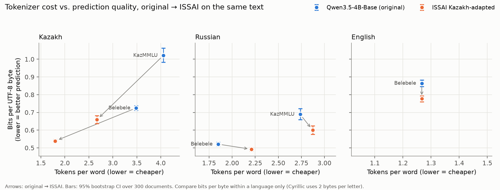

# What does extending Qwen3.5's vocabulary for Kazakh cost?

A tokenizer and evaluation audit of ISSAI's [`Qwen3.5-4B-Base-Kazakh`](https://huggingface.co/issai/Qwen3.5-4B-Base-Kazakh)
against the model it was adapted from, [`Qwen3.5-4B-Base`](https://huggingface.co/Qwen/Qwen3.5-4B-Base),
with the LLaMA-3.1 → Sherkala extension as a reference design.

This project **reproduces and extends** existing measurements (tokens per word, as in the
Sherkala paper) and adds tokenizer-independent and benchmark checks. It is not a new method.



## Summary

ISSAI extended Qwen3.5-4B-Base with 16,000 Kazakh tokens and continued pretraining; this audit
asks whether that kept what the original model could do. Comparing the two base models on the
same text and questions: Kazakh text needs 48% fewer tokens, the adapted model predicts Kazakh
text 26–36% better (bits per byte), and Kazakh benchmark accuracy rises by 3.7–5.4 points, most
on Kazakh history and literature (+12). The cost lands elsewhere: Russian text needs 19% more
tokens, traced to 1,880 added Cyrillic fragments that cut common Russian words apart (removing
them brings the extra cost to +1.9%), and English and Russian accuracy drops slightly (MMLU −1.5
points), even though the adapted model predicts English and Russian text *better*. The intrinsic
measure and the benchmarks disagree in direction for those languages, so neither alone is enough
to judge an adaptation. Not tested: the knowledge check on the author's sources, models larger
than 4B, and Sherkala as a model.

## Question

Open Kazakh models spend many tokens per word. ISSAI extended Qwen3.5's vocabulary by 16,000
Kazakh tokens and continued pretraining on ~15.7B tokens (50/50 Kazakh/English). Benchmarks
reportedly look similar to the original, but an adaptation can still lose something, and
tokens per word is a weak proxy for quality (Alqahtani et al., 2026).

**Main question:** does cutting tokens per word keep what the original model could do, and
where does it lose something?

1. How much cheaper is Kazakh text, and what happens to Russian and English? (Tables 1, 1b)
2. Why does Russian change? (Table 2)
3. Do token boundaries follow Kazakh stems and endings? (Table 3)
4. Does the adapted model predict Kazakh, Russian and English text as well? (Table 4)
5. Do standard benchmarks agree with the intrinsic results? (Table 6)
6. How does ISSAI's Kazakh-only extension compare with Sherkala's Kazakh+Russian+Turkish one? (Table 1b)

## Hypotheses (written before running) and outcome

| | Hypothesis | Outcome |
|---|---|---|
| H1 | The adapted tokenizer cuts Kazakh tokens by about half | **Supported** on Belebele (−48.4%); smaller on native exam text (−34.2%) |
| H2 | It makes Russian text more expensive | **Supported**, size depends on text: +19.4% Belebele, +4.9% KazMMLU |
| H3 | The adapted model has higher loss per byte on Russian | **Not supported**: ISSAI is *better* on Russian (−5.5% / −12.9% bits per byte) |
| H4 | Lower loss per byte on Kazakh, English not worse | **Supported**: Kazakh −25.7% / −35.5%; English −10.1% (better) |
| H5 | Benchmarks differ little while intrinsic measures differ more | **Partly supported**: benchmark changes are small (−2 to +5 points) while bits per byte moves 5–36%, but for English and Russian the two **disagree in direction** (better text prediction, slightly lower accuracy) |
| H6 | An extension that also adds Russian pieces (Sherkala) does not make Russian more expensive | **Supported**: LLaMA-3.1 → Sherkala Russian −14.8% on the same text |

## Models

| Name | Hugging Face id | Vocabulary | Notes |
|---|---|---|---|
| Original | `Qwen/Qwen3.5-4B-Base` | 248,077 (embedding rows 248,320) | Apache-2.0; 4,205,751,296 parameters as loaded |
| ISSAI adapted | `issai/Qwen3.5-4B-Base-Kazakh` | 264,077 (rows 264,192) | Apache-2.0; 4,246,383,616 parameters; +16,000 tokens, FVT init, ~15.7B tokens continued pretraining |
| LLaMA-3.1 (tokenizer only) | `meta-llama/Llama-3.1-8B` | 128,256 | gated |
| Sherkala (tokenizer only) | `inception42/Llama-3.1-Sherkala-8B-Chat` | 159,766 | gated; cc-by-nc-sa-4.0; only a Chat repo exists |

Both Qwen models tie input and output embeddings. Load-time checks are in
[notes/limitations.md](notes/limitations.md).

## Data

Belebele/FLORES passages (translated, parallel kk/ru/en, 300 passages), KazMMLU questions
(native Kazakh and Russian, 300 per language for running text, all 22,889 for the benchmark)
and English MMLU (14,042). Sources, licenses and sampling: [data/README.md](data/README.md).

## Results

### Table 1: tokenizer audit
Tokens per whitespace word (95% bootstrap CI over documents). Full table:
[results/tokenizer_audit.csv](results/tokenizer_audit.csv).

| Tokenizer | Belebele kk | Belebele ru | Belebele en | KazMMLU kk | KazMMLU ru |
|---|---|---|---|---|---|
| Qwen3.5 original | 3.48 (3.46–3.51) | 1.85 (1.83–1.88) | 1.27 | 4.05 (3.96–4.15) | 2.74 (2.64–2.84) |
| ISSAI | 1.80 (1.77–1.82) | 2.21 (2.18–2.23) | 1.27 | 2.67 (2.55–2.79) | 2.87 (2.78–2.97) |
| LLaMA-3.1 | 4.85 (4.81–4.89) | 2.20 (2.18–2.22) | 1.24 | 4.88 (4.77–5.00) | 2.87 (2.78–2.98) |
| Sherkala | 1.82 (1.80–1.84) | 1.88 (1.85–1.90) | 1.24 | 2.63 (2.52–2.75) | 2.60 (2.50–2.70) |

Kazakh-to-English token ratio on the parallel passages: 2.29 → 1.18 (Qwen → ISSAI),
3.25 → 1.22 (LLaMA-3.1 → Sherkala). Russian-to-English: 1.37 → 1.64 (Qwen → ISSAI),
1.67 → 1.42 (LLaMA-3.1 → Sherkala).

### Table 1b: two extension designs, relative change on the same text
Change in token count, extended tokenizer vs. its own base
([results/extension_change.csv](results/extension_change.csv)). Absolute values are not
compared across base tokenizers.

| | Qwen3.5 → ISSAI | LLaMA-3.1 → Sherkala (measured) | LLaMA-3.1 → Sherkala (paper, own text) |
|---|---|---|---|
| Base vocabulary | 248,077 | 128,256 | 128,256 |
| Tokens added | 16,000, Kazakh | ~31,500, Kazakh + Russian + Turkish | |
| Kazakh, Belebele | −48.4% (−49.2 to −47.6) | −62.5% (−63.0 to −61.9) | −56.8% |
| Kazakh, KazMMLU | −34.2% (−36.2 to −32.1) | −46.1% (−48.2 to −43.8) | |
| Russian, Belebele | **+19.4%** (18.5 to 20.4) | −14.8% (−15.3 to −14.4) | −13.8% |
| Russian, KazMMLU | **+4.9%** (3.8 to 6.2) | −9.6% (−10.4 to −8.7) | |
| English, Belebele | 0.0% | 0.0% | |

The Sherkala paper's relative changes reproduce closely on different text (Russian −14.8% vs.
−13.8%; Kazakh −62.5% vs. −56.8%).

### Table 2: why Russian gets more expensive
The ISSAI tokenizer has the **same** BPE vocabulary, merge list, normalizer and pre-tokenizer
as the original ([results/tokenizer_structure.csv](results/tokenizer_structure.csv)). All 16,000
new pieces are stored as *added tokens*, which the Hugging Face tokenizer matches in the raw
text **before** BPE runs. (Sherkala also stores its ~31,500 additions as added tokens:
[results/extension_structure.csv](results/extension_structure.csv).)

5,531 of ISSAI's added tokens contain no Kazakh-specific letter (ә ғ қ ң ө ұ ү һ і). Some are
whole Kazakh words (` болады`); 1,880 have no leading space and can fire in the middle of any
Cyrillic word (`оры`, `ег`, `ест`). In Russian Belebele text, 22.3% of running words are split
into more pieces than before, 3.0% into fewer, and every word that got longer contains a new
token. Most frequent examples ([results/russian_splits.csv](results/russian_splits.csv)):

| Word | Freq. | Original | ISSAI |
|---|---|---|---|
| которые | 61 | `которые` | `кот · оры · е` |
| является | 57 | `является` | `я · вл · яется` |
| его | 50 | `его` | `ег · о` |
| быть | 49 | `быть` | `б · ыт · ь` |
| есть | 34 | `есть` | `ест · ь` |
| если | 32 | `если` | `ес · ли` |
| обычно | 29 | `обычно` | `об · ыч · но` |
| несколько | 25 | `несколько` | `н · еск · олько` |
| будет | 22 | `будет` | `б · уде · т` |
| между | 19 | `между` | `м · еж · ду` |

**Counterfactual test** ([results/russian_counterfactual.csv](results/russian_counterfactual.csv)):
rebuilding the ISSAI tokenizer without some of the added tokens and counting again.

| Tokenizer variant | Kazakh, Belebele | Russian, Belebele | Kazakh, KazMMLU | Russian, KazMMLU |
|---|---|---|---|---|
| ISSAI as released | −48.4% | +19.4% | −34.2% | +4.9% |
| Drop 1,880 mid-word fragments without a Kazakh letter | −47.8% | +1.9% | −30.1% | +0.2% |
| Drop all 5,531 tokens without a Kazakh letter | −36.4% | 0.0% | −24.9% | 0.0% |

Dropping 12% of the added tokens keeps almost all of the Kazakh saving on Belebele and
removes ~90% of the Russian cost. This is a tokenizer-only result: the model was trained with
the released tokenizer, so these variants would need retraining or at least re-evaluation.

### Table 3: do token boundaries follow stems and endings?
110 frequent Kazakh words segmented into stem + endings
([data/kk_segmentation.tsv](data/kk_segmentation.tsv), 194 morpheme boundaries;
[results/stem_alignment.csv](results/stem_alignment.csv)).

| Tokenizer | Pieces per word | Boundary recall | Boundary precision | Stem kept whole |
|---|---|---|---|---|
| Qwen3.5 original | 4.05 | 0.61 | 0.35 | 0.18 |
| ISSAI | 1.10 | 0.02 | 0.30 | 0.02 |
| LLaMA-3.1 | 5.89 | 0.62 | 0.27 | 0.13 |
| Sherkala | 1.23 | 0.07 | 0.54 | 0.06 |

Both extended tokenizers store most frequent inflected forms as single tokens
(`адамдардың`, `пайдаланылатын`), so they rarely cut at a morpheme boundary at all. The base
tokenizers cut at more true boundaries only because they cut almost everywhere (precision
0.27–0.35). Low fertility therefore does not mean the splits follow Kazakh morphology; here
it means whole word forms were memorized. The sample is biased toward frequent words.

### Table 4: bits per byte (tokenizer-independent)
Each document scored separately, bf16 weights, fp32 log-softmax, `<|endoftext|>` prefix so
every byte is predicted, no padding. Paired difference resamples the same documents
([results/bits_per_byte.csv](results/bits_per_byte.csv)).

| Text | Original | ISSAI | ISSAI − original (95% CI) | Change | Docs where ISSAI is better |
|---|---|---|---|---|---|
| Kazakh, Belebele | 0.725 | 0.539 | −0.186 (−0.195 to −0.178) | −25.7% | 300 / 300 |
| Kazakh, KazMMLU | 1.021 | 0.659 | −0.362 (−0.387 to −0.339) | −35.5% | 300 / 300 |
| Russian, Belebele | 0.521 | 0.492 | −0.029 (−0.032 to −0.026) | −5.5% | 257 / 300 |
| Russian, KazMMLU | 0.689 | 0.600 | −0.089 (−0.100 to −0.079) | −12.9% | 277 / 300 |
| English, Belebele | 0.864 | 0.777 | −0.087 (−0.094 to −0.081) | −10.1% | 295 / 300 |

Compare within a language only: Cyrillic letters take 2 bytes in UTF-8, Latin letters 1.

Even though Russian costs 19% more tokens under ISSAI, the ISSAI model predicts Russian text
better per byte. Each Russian token carries less information, and the model spends fewer bits
on each (2.99 vs. 3.78 bits per token on Belebele). The English gain, with identical
tokenization, shows that continued pretraining changed more than the Kazakh part; with
undisclosed training data we cannot tell whether this reflects general improvement or overlap
with FLORES/Belebele-like text.

### Table 5: knowledge check (pilot)
Not run yet. It needs ~30 questions written from the author's books, with answers fixed
before running the models. The runner is ready: `make knowledge`
([scripts/knowledge_check.py](scripts/knowledge_check.py)).

### Table 6: benchmarks

Zero-shot, identical prompts for both models; prediction = highest next-token score among the
answer letters (same token ids in both tokenizers). Accuracy with 95% Wilson interval;
difference with a paired bootstrap over the same questions
([results/benchmarks.csv](results/benchmarks.csv), per item: `results/bench_items_*.csv`).

| Benchmark | n | Original | ISSAI | ISSAI − original, points (95% CI) | Only orig. right / only ISSAI right |
|---|---|---|---|---|---|
| Belebele Kazakh | 900 | 71.4% | **75.1%** | **+3.7** (+1.1 to +6.2) | 55 / 88 |
| KazMMLU Kazakh track | 9,870 | 54.2% | **59.6%** | **+5.4** (+4.4 to +6.4) | 1,021 / 1,551 |
| Belebele Russian | 900 | 85.3% | 83.2% | −2.1 (−4.2 to 0.0) | 57 / 38 |
| KazMMLU Russian track | 13,019 | 62.5% | 62.3% | −0.2 (−0.9 to +0.6) | 1,229 / 1,207 |
| Belebele English | 900 | 92.4% | 91.1% | −1.3 (−2.7 to 0.0) | 24 / 12 |
| MMLU (English) | 14,042 | 74.4% | 72.9% | **−1.5** (−2.0 to −1.0) | 683 / 468 |

Chance is 25% (Belebele, MMLU) and ~22–24% (KazMMLU, 4–5 options).

By KazMMLU subject ([results/kazmmlu_by_subject.csv](results/kazmmlu_by_subject.csv)), the
largest changes follow the content, not only the language of the question:

| Largest gains | Points | Largest losses | Points |
|---|---|---|---|
| Kazakh Literature (kk) | +12.1 | Russian Literature (ru) | −4.1 |
| Kazakh History (kk) | +11.9 | Medicine (ru) | −4.0 |
| Kazakh History (ru) | +9.2 | World History (ru) | −3.6 |
| Biology (kk) | +7.7 | Law (ru) | −3.3 |
| Geography (kk) | +6.8 | Russian Language (ru) | −2.9 |
| Kazakh Language (kk) | +6.6 | Math (kk) | −2.6 |

Kazakh History improves even when asked in Russian (+9.2), so part of the gain is knowledge
about Kazakhstan rather than reading Kazakh. Per-subject differences are not corrected for
multiple comparisons; subjects with ~300 questions have intervals of roughly ±4 points.

## Discussion

**What held.** The extension does what it was built for: Kazakh is about half the tokens, the
model predicts Kazakh text much better, and it answers Kazakh questions better, especially on
Kazakh-specific knowledge. Sherkala's published fertility numbers reproduce on our text.

**What did not.** We expected Russian text prediction to get worse (H3); it got better. The
tokenizer makes Russian more expensive, but the model is not worse at predicting it.

**What the benchmarks show that bits per byte does not.** For English and Russian, the adapted
model is less surprised by text but slightly worse at answering questions (MMLU −1.5 points,
significant; Belebele Russian and English −2.1 and −1.3, borderline). The losses concentrate in
Russian literature and language and in general knowledge subjects. One possible reading is that
continued pretraining on Kazakh and English web text improved fluency while some stored knowledge
or exam-format skill faded; another is overlap between the adaptation data and our test text,
which would lower bits per byte without adding ability. We did not test which.

**What the benchmarks hide.** Averages like KazMMLU Russian (−0.2 points) hide subject-level
movement in both directions (Kazakh History in Russian +9.2, Russian Literature −4.1).

**Checks worth doing before releasing a vocabulary extension:**
1. Count tokens for every language the users write, not only the target (here: Russian).
2. Check added tokens that can fire inside words of other languages (here: 1,880 fragments
   explain ~90% of the extra Russian tokens).
3. Report a tokenizer-independent measure (bits per byte) per language.
4. Report retention benchmarks per subject, not only averages.

## Limitations
See [notes/limitations.md](notes/limitations.md). In short: Belebele is translated; samples are
small (300 documents, 110 words); training data of both models is only partly known; base
models at one size (4B); benchmarks use one zero-shot prompt format; the segmentation file
covers frequent words; Sherkala is compared as a tokenizer only; the knowledge check is not
run.

## Reproduce

```bash
uv sync                      # or: pip install -r requirements.txt
hf auth login                # LLaMA-3.1 and Sherkala tokenizers are gated; accept their terms first
make audit splits stems      # Tables 1, 1b, 2, 3 (CPU, minutes)
make bpb                     # Table 4 (GPU, ~5 min)
make bench                   # Table 6 (GPU, ~2.5 h)
make figure
```

Each GPU step loads one model at a time and refuses to start if no GPU has 14 GB free
(written for a shared node). Downloads go to `./hf` (git-ignored).

Run on 25 October 2026 (bits per byte ~2 min per model; benchmarks ~55 min per model): one NVIDIA A100-SXM4-40GB share (~16 GB free), Python 3.11.15,
torch 2.6.0, transformers 5.20.2, tokenizers 0.23.3, datasets 5.1.0 (all pins in
[requirements.txt](requirements.txt)); fast linear-attention kernels not installed (reference
PyTorch path). Seed 0 for all sampling and bootstrap.

## Layout

```
README.md                 this file
TODO.md                   original project plan
Makefile                  one target per table
requirements.txt
data/README.md            sources, licenses (no book text)
data/kk_segmentation.tsv  stem + ending segmentations
scripts/common.py         paths, data loaders, GPU picker
scripts/audit.py          Tables 1, 1b
scripts/russian_splits.py Table 2 + counterfactual tokenizers
scripts/stem_check.py     Table 3
scripts/bits_per_byte.py  Table 4
scripts/knowledge_check.py Table 5
scripts/benchmarks.py     Table 6
scripts/figure.py         figure
results/*.csv             every number in this README
figures/*.png
notes/limitations.md
```

## References
- ISSAI, `issai/Qwen3.5-4B-Base-Kazakh` model card.
- Sherkala: Koto et al., *Llama-3.1-Sherkala-8B-Chat: An Open Large Language Model for Kazakh* (2025).
- Bandarkar et al., *The Belebele Benchmark* (2024).
- Togmanov et al., *KazMMLU* (2025).
- Hendrycks et al., *Measuring Massive Multitask Language Understanding* (2021).
- Alqahtani et al. (2026), position paper on vocabulary expansion (cited in the plan).
