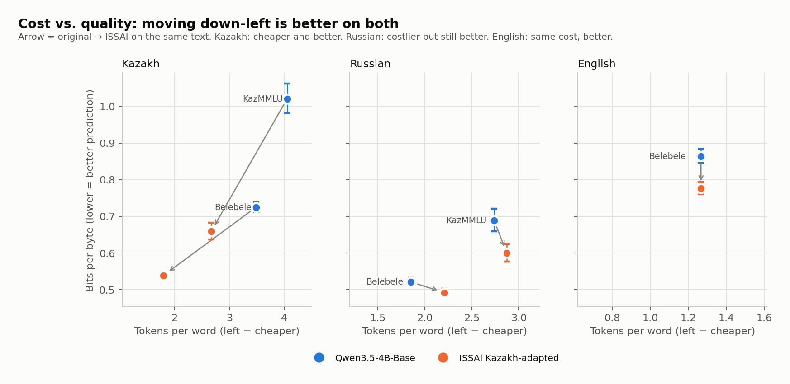
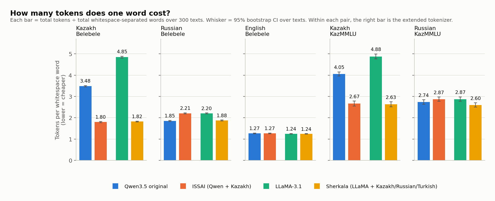
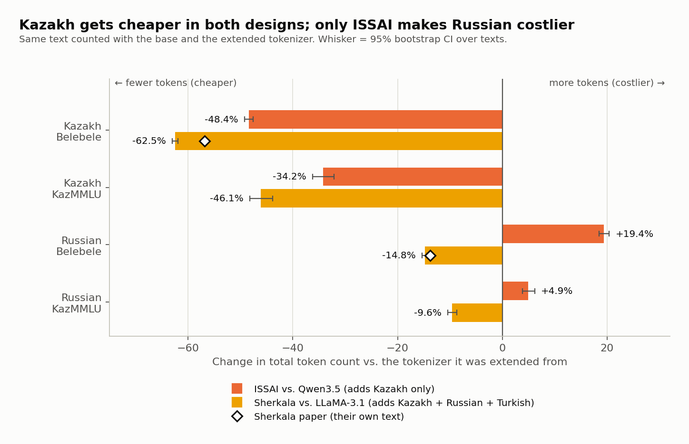
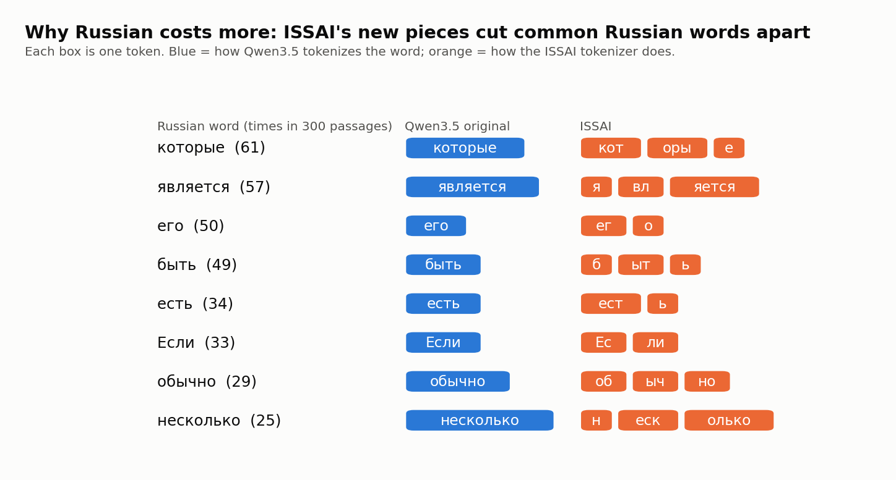
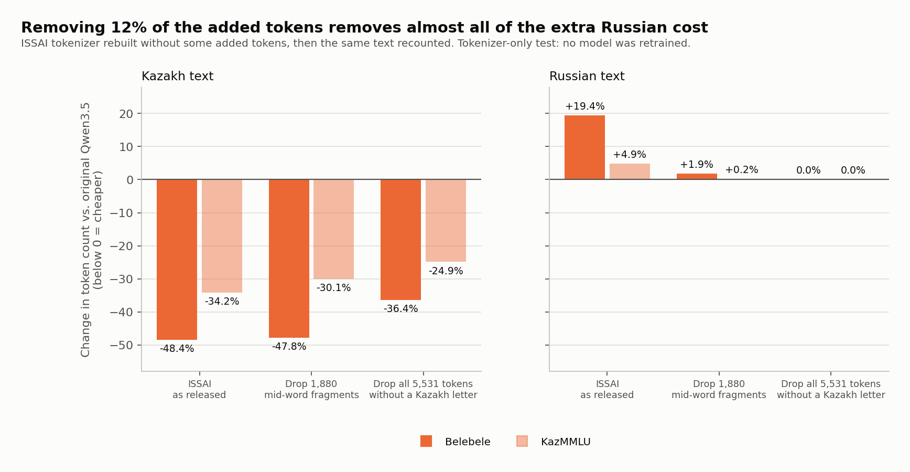
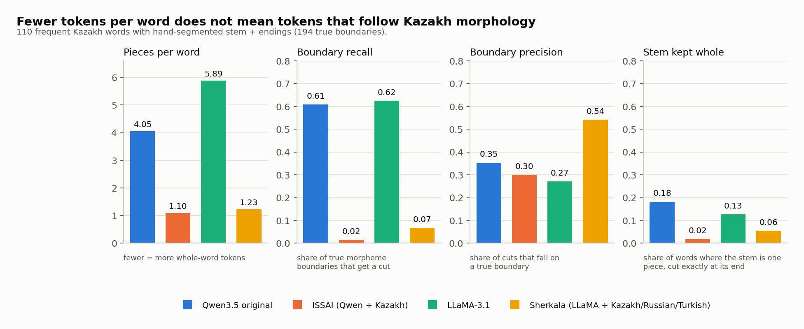
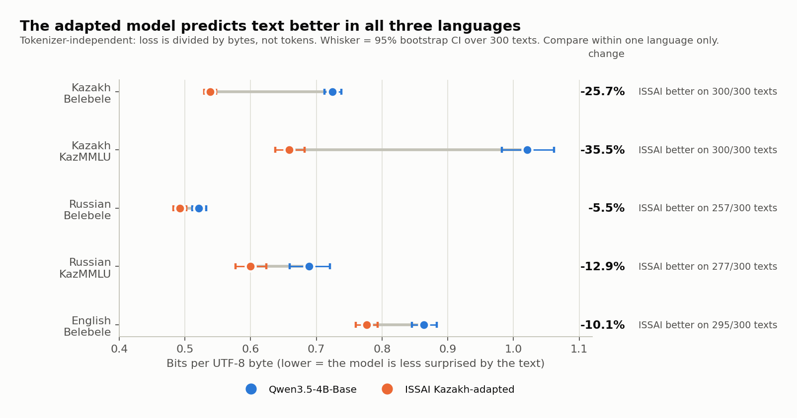
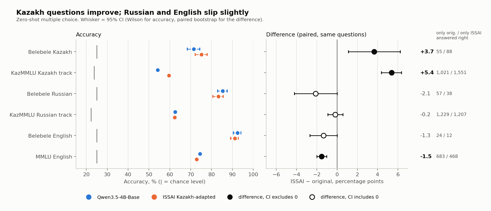
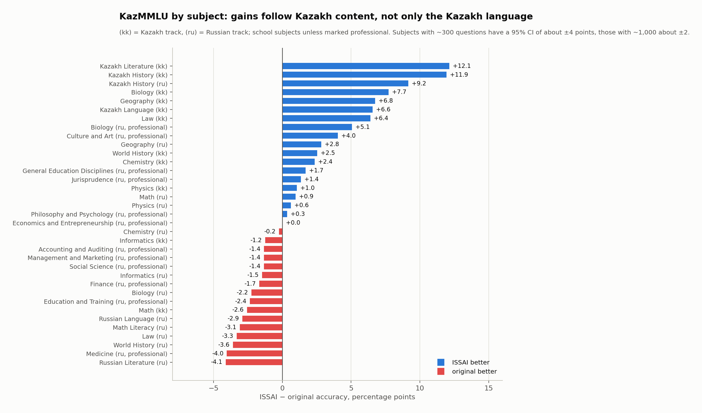

# What does extending Qwen3.5's vocabulary for Kazakh cost?

A tokenizer and evaluation audit of ISSAI's [`Qwen3.5-4B-Base-Kazakh`](https://huggingface.co/issai/Qwen3.5-4B-Base-Kazakh)
against the model it was adapted from, [`Qwen3.5-4B-Base`](https://huggingface.co/Qwen/Qwen3.5-4B-Base),
with the LLaMA-3.1 → Sherkala extension as a reference design.

This project **reproduces and extends** existing measurements (tokens per word, as in the
Sherkala paper) and adds tokenizer-independent and benchmark checks. It is not a new method.



**How to read this.** Each panel is one language. Every dot is one text set (Belebele or
KazMMLU). The blue dot is the original model, the orange dot is the ISSAI model on the *same*
text, and the arrow joins them. Left = fewer tokens per word (cheaper). Down = lower
bits per byte (the model is less surprised by the text, so it predicts it better). An arrow
pointing down-left is better on both. Compare heights within one panel only: Cyrillic letters
take 2 bytes and Latin letters 1, so bits per byte is not comparable across languages.

## Summary

ISSAI extended Qwen3.5-4B-Base with 16,000 Kazakh tokens and continued pretraining; this audit
asks whether that kept what the original model could do. Comparing the two base models on the
same text and questions: Kazakh text needs 48% fewer tokens, the adapted model predicts Kazakh
text 26–36% better (bits per byte), and Kazakh benchmark accuracy rises by 3.7–5.4 points, most
on Kazakh history and literature (+12). The cost lands elsewhere: Russian text needs 19% more
tokens, traced to 1,880 added Cyrillic fragments that cut common Russian words apart (removing
them brings the extra cost to +1.9%), and English and Russian accuracy drops slightly (MMLU −1.5
points), even though the adapted model predicts English and Russian text *better*. The intrinsic
measure and the benchmarks disagree in direction for those languages, so neither alone is enough
to judge an adaptation. Not tested: models larger than 4B, and Sherkala as a model.

## Question

Open Kazakh models spend many tokens per word. ISSAI extended Qwen3.5's vocabulary by 16,000
Kazakh tokens and continued pretraining on ~15.7B tokens (50/50 Kazakh/English). Benchmarks
reportedly look similar to the original, but an adaptation can still lose something, and
tokens per word is a weak proxy for quality (Alqahtani et al., 2026).

**Main question:** does cutting tokens per word keep what the original model could do, and
where does it lose something?

1. How much cheaper is Kazakh text, and what happens to Russian and English? (Figures 1, 2)
2. Why does Russian change? (Figures 3a, 3b)
3. Do token boundaries follow Kazakh stems and endings? (Figure 4)
4. Does the adapted model predict Kazakh, Russian and English text as well? (Figure 5)
5. Do standard benchmarks agree with the intrinsic results? (Figures 6, 7)
6. How does ISSAI's Kazakh-only extension compare with Sherkala's Kazakh+Russian+Turkish one? (Figure 2)

## Terms used in the charts

- **Token.** The unit a language model reads. A tokenizer cuts text into tokens; a word can be
  one token or several. More tokens per text means slower and costlier use of the model.
- **Tokens per word.** Total tokens ÷ total words, where a word is a whitespace-separated
  string. Lower is cheaper. It is not comparable across languages (Kazakh packs more meaning
  into one word than English does).
- **Bits per byte.** The model's average loss on a text, in bits, divided by the text's size in
  UTF-8 bytes. Lower means the model predicts the text better. Dividing by bytes instead of
  tokens makes two models with different tokenizers comparable.
- **Whisker.** A 95% confidence interval: the range the number would plausibly fall in if we had
  drawn a different sample of texts or questions. Where two whiskers do not overlap, or a
  difference's whisker excludes 0, the gap is unlikely to be chance.
- **Chance level.** The accuracy of random guessing (25% with 4 options).
- **Belebele.** Reading-comprehension questions on translated passages, the same passage in
  Kazakh, Russian and English. **KazMMLU.** Native Kazakhstani school and university exam
  questions, in a Kazakh track and a Russian track. **MMLU.** English multi-subject exam
  questions.

## Models

- **Original:** `Qwen/Qwen3.5-4B-Base`. Vocabulary 248,077. Apache-2.0.
- **ISSAI adapted:** `issai/Qwen3.5-4B-Base-Kazakh`. Vocabulary 264,077 (+16,000 Kazakh tokens,
  FVT initialization, ~15.7B tokens of continued pretraining). Apache-2.0.
- **LLaMA-3.1** (tokenizer only): `meta-llama/Llama-3.1-8B`. Vocabulary 128,256. Gated.
- **Sherkala** (tokenizer only): `inception42/Llama-3.1-Sherkala-8B-Chat`. Vocabulary 159,766
  (~31,500 added for Kazakh, Russian and Turkish). Gated, cc-by-nc-sa-4.0; only a Chat repo exists.

Both Qwen models tie input and output embeddings. Load-time checks are in
[notes/limitations.md](notes/limitations.md).

## Data

Belebele/FLORES passages (translated, parallel kk/ru/en, 300 passages), KazMMLU questions
(native Kazakh and Russian, 300 per language for running text, all 22,889 for the benchmark)
and English MMLU (14,042). Sources, licenses and sampling: [data/README.md](data/README.md).

## Results

### Figure 1: how many tokens does one word cost?



**How to read this.** Each panel is one language and text set. Each bar is one tokenizer's
tokens per word; the number on top is the value and the whisker is its 95% interval over
documents. In each pair the left bar is the base tokenizer and the right bar is its extended
version (Qwen → ISSAI, LLaMA → Sherkala). Shorter is cheaper.

- Kazakh: both extensions roughly halve the cost (3.48 → 1.80 and 4.85 → 1.82 on Belebele).
- Russian: ISSAI gets **worse** (1.85 → 2.21), Sherkala gets better (2.20 → 1.88).
- English: unchanged, as it should be.

The numbers are in [results/tokenizer_audit.csv](results/tokenizer_audit.csv). That file also has
`tokens_vs_en`, the ratio of **total tokens** to the English version of the same passage: Kazakh
2.29 → 1.18 (Qwen → ISSAI) and 3.25 → 1.22 (LLaMA → Sherkala); Russian 1.37 → 1.64 and
1.67 → 1.42. This is a ratio of total tokens, not of the tokens-per-word bars: the Kazakh
passages have fewer words than the English ones (19,404 vs. 23,271), so it is smaller than the
ratio of the bars.

### Figure 2: two extension designs, compared on the same text



**How to read this.** Each bar is the change in **total token count** of an extended tokenizer
compared with the tokenizer it was built from, on the same text. A bar pointing left means
fewer tokens (cheaper); right means more (costlier). Orange is ISSAI vs. Qwen3.5, yellow is
Sherkala vs. LLaMA-3.1. Whiskers are 95% intervals. The white diamonds are the values published
in the Sherkala paper, measured on their own text.

Kazakh gets cheaper under both designs (ISSAI −48% on Belebele, Sherkala −62%). Only ISSAI makes
Russian costlier (+19.4% on Belebele, +4.9% on KazMMLU), while Sherkala, which also added Russian
pieces, makes it cheaper (−14.8%, −9.6%). Our Sherkala numbers reproduce the paper's on different
text (Russian −14.8% vs. −13.8%; Kazakh −62.5% vs. −56.8%). Absolute values are not compared across
base tokenizers. Data: [results/extension_change.csv](results/extension_change.csv).

### Figure 3: why Russian gets more expensive

The ISSAI tokenizer has the **same** BPE vocabulary, merge list, normalizer and pre-tokenizer
as the original ([results/tokenizer_structure.csv](results/tokenizer_structure.csv)). All 16,000
new pieces are stored as *added tokens*, which the Hugging Face tokenizer matches in the raw
text **before** BPE runs. (Sherkala also stores its ~31,500 additions as added tokens:
[results/extension_structure.csv](results/extension_structure.csv).)

5,531 of ISSAI's added tokens contain no Kazakh-specific letter (ә ғ қ ң ө ұ ү һ і). Some are
whole Kazakh words (` болады`); 1,880 have no leading space and can fire in the middle of any
Cyrillic word (`оры`, `ег`, `ест`). In Russian Belebele text, 22.3% of running words are split
into more pieces than before, 3.0% into fewer, and every word that got longer contains a new
token.



**How to read this.** Each row is a common Russian word, with how often it occurs in the 300
passages. Each box is one token. Blue boxes are how the original Qwen3.5 tokenizer writes the
word (usually one token); orange boxes are how ISSAI's does. Many frequent words get chopped
into short fragments (`которые` → `кот · оры · е`). Data:
[results/russian_splits.csv](results/russian_splits.csv).



**How to read this.** We rebuilt the ISSAI tokenizer without some of the added tokens and
counted the same text again. Each group of bars is one variant; the dark bar is Belebele, the
pale bar is KazMMLU. Bars below zero mean fewer tokens than the original Qwen3.5 tokenizer
(cheaper), above zero mean more. Left panel: Kazakh. Right panel: Russian.

Dropping the 1,880 mid-word fragments (12% of the added tokens) keeps almost all of the Kazakh
saving on Belebele (−47.8% vs. −48.4%) and cuts the Russian cost from +19.4% to +1.9%. This is a
tokenizer-only result: the model was trained with the released tokenizer, so these variants
would need retraining or at least re-evaluation. Data:
[results/russian_counterfactual.csv](results/russian_counterfactual.csv).

### Figure 4: do token boundaries follow stems and endings?



**How to read this.** 110 frequent Kazakh words were hand-segmented into stem + endings
([data/kk_segmentation.tsv](data/kk_segmentation.tsv), 194 true morpheme boundaries). Each panel
is one measure; each bar is one tokenizer (same colors as Figure 1).

- **Pieces per word:** how many tokens the word is cut into.
- **Boundary recall:** of the 194 true boundaries, the share where the tokenizer also cuts.
- **Boundary precision:** of the cuts the tokenizer makes inside a word, the share that fall on a
  true boundary.
- **Stem kept whole:** the share of words where the stem is a single piece, cut exactly at its end.

Both extended tokenizers store most frequent inflected forms as single tokens
(`адамдардың`, `пайдаланылатын`), so they rarely cut at a morpheme boundary at all (recall 0.02 and 0.07). The base tokenizers cut at more true boundaries only because they cut
almost everywhere (precision 0.27–0.35). Low tokens per word therefore does not mean the splits follow
Kazakh morphology; it means whole word forms were memorized. The sample is biased toward frequent
words. Data: [results/stem_alignment.csv](results/stem_alignment.csv).

### Figure 5: bits per byte (tokenizer-independent)



**How to read this.** Each row is one text set. The blue dot is the original model's bits per
byte, the orange dot is ISSAI's, and the line between them is the gap; whiskers are 95% intervals
over documents. Dots further left mean the model predicts the text better. The bold number is the
change in bits per byte, and the grey text counts the documents (of 300) where ISSAI is better.
Compare rows within one language only.

Each document was scored separately (bf16 weights, fp32 log-softmax, `<|endoftext|>` prefix so
every byte is predicted, no padding). The paired difference resamples the same documents. Data:
[results/bits_per_byte.csv](results/bits_per_byte.csv).

Even though Russian costs 19% more tokens under ISSAI, the ISSAI model predicts Russian text
better per byte. Each Russian token carries less information, and the model spends fewer bits
on each (2.99 vs. 3.78 bits per token on Belebele). The English gain, with identical
tokenization, shows that continued pretraining changed more than the Kazakh part; with
undisclosed training data we cannot tell whether this reflects general improvement or overlap
with FLORES/Belebele-like text.

### Figure 6: benchmarks



**How to read this.** Each row is one benchmark. The model gets each question once, zero-shot, and
we record whether it picked the right answer letter (see *How the benchmarks were run* below).

- **Left panel, accuracy.** Blue dot = original, orange dot = ISSAI (original slightly above,
  ISSAI slightly below, so they do not hide each other). Whiskers are 95% Wilson intervals. The
  grey tick is the chance level.
- **Right panel, difference.** One dot per row: ISSAI accuracy minus original accuracy, in
  percentage points, with a 95% interval from a paired bootstrap over the same questions. Right of
  zero = ISSAI better. A **filled** dot means the interval excludes zero, so the change is
  unlikely to be chance; a **hollow** dot means it includes zero.
- **Numbers on the far right.** How many questions only the original answered correctly, and how
  many only ISSAI did. Both models are right or wrong together on most questions; these are the
  ones where they differ.

Kazakh improves (+3.7 on Belebele, +5.4 on KazMMLU). Russian and English move slightly down
(MMLU −1.5 is the only clearly significant drop; Belebele Russian and English are borderline).
Data: [results/benchmarks.csv](results/benchmarks.csv), per item in `results/bench_items_*.csv`.

**How the benchmarks were run.** Each question is turned into one fixed prompt (passage, question,
lettered options, then `Answer:` in the question's language), identical for both models. One
forward pass gives the model's scores for the next token. The prediction is the answer letter with
the highest score among the item's valid letters (` A`…` E` are the same single token ids in both
tokenizers). The model never writes an answer, so there is nothing to parse. Batch size 1, no
padding.



**How to read this.** Each bar is one KazMMLU subject: ISSAI accuracy minus original accuracy, in
percentage points. Blue (right) = ISSAI better, red (left) = original better. `(kk)` is the Kazakh
track, `(ru)` the Russian track, and "professional" marks university-level subjects; the rest are
school subjects. Data: [results/kazmmlu_by_subject.csv](results/kazmmlu_by_subject.csv).

The largest changes follow the content, not only the language of the question. Kazakh Literature
(+12.1) and Kazakh History (+11.9) gain most, and Kazakh History improves even when asked in
Russian (+9.2), so part of the gain is knowledge about Kazakhstan rather than reading Kazakh. The
largest losses are Russian Literature (−4.1), Medicine (−4.0) and World History (−3.6), all in the
Russian track. Per-subject differences are not corrected for multiple comparisons; a subject with
~300 questions has an interval of roughly ±4 points, one with ~1,000 about ±2.

## Hypotheses (written before running) and outcome

| | Hypothesis | Outcome |
|---|---|---|
| H1 | The adapted tokenizer cuts Kazakh tokens by about half | **Supported** on Belebele (−48.4%); smaller on native exam text (−34.2%) |
| H2 | It makes Russian text more expensive | **Supported**, size depends on text: +19.4% Belebele, +4.9% KazMMLU |
| H3 | The adapted model has higher loss per byte on Russian | **Not supported**: ISSAI is *better* on Russian (−5.5% / −12.9% bits per byte) |
| H4 | Lower loss per byte on Kazakh, English not worse | **Supported**: Kazakh −25.7% / −35.5%; English −10.1% (better) |
| H5 | Benchmarks differ little while intrinsic measures differ more | **Partly supported**: benchmark changes are small (−2 to +5 points) while bits per byte moves 5–36%, but for English and Russian the two **disagree in direction** (better text prediction, slightly lower accuracy) |
| H6 | An extension that also adds Russian pieces (Sherkala) does not make Russian more expensive | **Supported**: LLaMA-3.1 → Sherkala Russian −14.8% on the same text |

## Discussion

**The extension works for Kazakh.** Kazakh text needs about half the tokens, the model predicts it
26–36% better per byte, and it answers Kazakh questions 3.7–5.4 points more accurately. The gain
is largest where the content is Kazakh: Kazakh Literature (+12.1) and Kazakh History (+11.9), and
Kazakh History improves even when the question is asked in Russian (+9.2). So part of what the
continued pretraining added is knowledge about Kazakhstan, not only the ability to read Kazakh.

**The cost shows up in Russian tokens, not in Russian prediction.** ISSAI's Kazakh tokenizer makes
Russian text 19% longer (Figure 2), and a small group of added pieces explains almost all of it:
1,880 fragments that can fire in the middle of any Cyrillic word and cut ordinary Russian words
apart (Figure 3). Dropping just those would remove ~90% of the extra cost and keep almost all of the
Kazakh saving, so the cost comes from a small, identifiable part of the extension.
Sherkala, which added Russian pieces on purpose, made Russian cheaper instead. We expected the
model to also predict Russian text worse; it predicts it better (Figure 5).

**Prediction and accuracy disagree for English and Russian.** The adapted model is less surprised by
English and Russian text, yet answers questions slightly worse (MMLU −1.5 points, the only clearly
significant drop; Belebele Russian −2.1 and English −1.3 are borderline). The losses concentrate in
Russian literature and language, medicine, law and world history (Figure 7). We see two readings and
did not test which holds: continued pretraining on Kazakh and English web text may have improved
fluency while some stored knowledge or exam-format skill faded, or the adaptation data may overlap
with FLORES/Belebele-like text, which would lower bits per byte without adding ability. Because the
training data is only partly published, we cannot separate them.

**Fewer tokens is not the same as better tokens.** Both extended tokenizers memorize whole Kazakh
word forms, so their cuts rarely land on stem/ending boundaries (Figure 4). Tokens per word, the
usual headline number, says how much a text costs, not how well the model handles it, and in this
audit it moved in the opposite direction from accuracy for Russian and English.

**Averages hide movement.** KazMMLU Russian is flat overall (−0.2 points) but contains Kazakh
History at +9.2 and Russian Literature at −4.1.

**Scope.** One model size (4B), base models only, one zero-shot prompt format, translated
(Belebele) and exam (KazMMLU) text, and Sherkala compared as a tokenizer only.

## Next steps

1. **Cultural heritage check (Qwen original vs. ISSAI).** The largest benchmark gains were on
   Kazakh History and Literature (Figure 7), so this is where a closer look pays most. Write
   100–200 multiple-choice questions from sources the author knows (history, literature,
   traditions, language), fix the answers before running any model, and ask each question in
   Kazakh, Russian and English. Asking the same question in three languages separates "knows
   Kazakh culture" from "reads Kazakh". Use the same zero-shot letter-scoring protocol as the
   benchmarks and report the paired difference with an interval. About 30 questions is only a
   pilot: its 95% interval is roughly ±17 points, too wide to see a 5-point change.
2. **Sherkala as a model, not only a tokenizer.** Do this after step 1, reusing its question set.
   The fair pair is LLaMA-3.1-8B-Instruct vs. Sherkala-8B-Chat, because only a Chat version of
   Sherkala exists; comparing it with the 4B Qwen models would mix model size, model family and
   instruction tuning. It needs a chat-style prompt, and an 8B model in bf16 takes ~16 GB, which
   does not fit the ~16 GB GPU share used so far (use 8-bit loading or another node).
3. **Test the overlap explanation.** Bits per byte improved even for English, which could be
   real improvement or overlap between the adaptation data and FLORES/Belebele-style text. Score
   both models on text published after their training data was collected; if the gain on
   English and Russian shrinks, overlap explains part of it.

## Reproduce

```bash
uv sync                      # or: pip install -r requirements.txt
hf auth login                # LLaMA-3.1 and Sherkala tokenizers are gated; accept their terms first
make audit splits stems      # Figures 1, 2, 3, 4 (CPU, minutes)
make bpb                     # Figure 5 (GPU, ~5 min)
make bench                   # Figures 6, 7 (GPU, ~2.5 h)
make figure                  # draws every figure from results/*.csv (CPU, seconds)
```

Each GPU step loads one model at a time and refuses to start if no GPU has 14 GB free
(written for a shared node). Downloads go to `./hf` (git-ignored).

Run on 25 October 2026 (bits per byte ~2 min per model; benchmarks ~55 min per model): one NVIDIA A100-SXM4-40GB share (~16 GB free), Python 3.11.15,
torch 2.6.0, transformers 5.20.2, tokenizers 0.23.3, datasets 5.1.0 (all pins in
[requirements.txt](requirements.txt)); fast linear-attention kernels not installed (reference
PyTorch path). Seed 0 for all sampling and bootstrap.

## Layout

```
README.md                 this file
TODO.md                   original project plan
Makefile                  one target per figure
requirements.txt
data/README.md            sources, licenses (no book text)
data/kk_segmentation.tsv  stem + ending segmentations
scripts/common.py         paths, data loaders, GPU picker
scripts/audit.py          Figures 1, 2
scripts/russian_splits.py Figure 3 + counterfactual tokenizers
scripts/stem_check.py     Figure 4
scripts/bits_per_byte.py  Figure 5
scripts/benchmarks.py     Figures 6, 7
scripts/figure.py         draws all figures
results/*.csv             every number in this README
figures/*.png
notes/limitations.md
```

## References
- ISSAI, `issai/Qwen3.5-4B-Base-Kazakh` model card.
- Sherkala: Koto et al., *Llama-3.1-Sherkala-8B-Chat: An Open Large Language Model for Kazakh* (2025).
- Bandarkar et al., *The Belebele Benchmark* (2024).
- Togmanov et al., *KazMMLU* (2025).
- Hendrycks et al., *Measuring Massive Multitask Language Understanding* (2021).
- Alqahtani et al. (2026), position paper on vocabulary expansion (cited in the plan).
